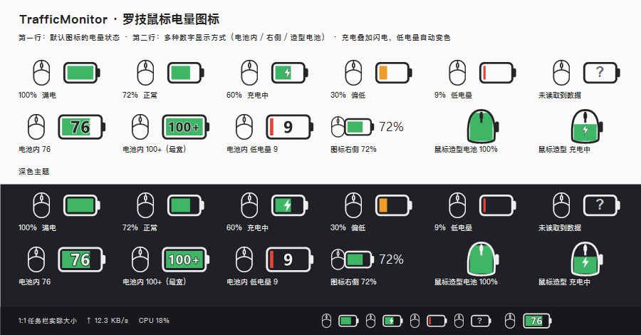
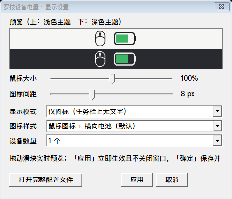
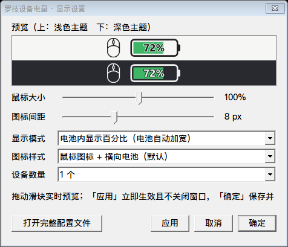

# LogitechBatteryPlugin

**TrafficMonitor 的罗技鼠标电量插件**：在任务栏 / 主窗口显示一枚「鼠标 + 电池」图标，没有任何文字。电量通过罗技 HID++ 协议直接从硬件读取，不需要安装或运行 G HUB / Options+。





> 这是第三方插件，与 Logitech（罗技）及 TrafficMonitor 作者无关。仅支持 Windows。

## 特性

| | |
|---|---|
| 纯图标 | 任务栏上一个字都没有；鼠标线稿 + 手机电池式电量条 |
| 四种数字方式 | 不显示 / **电池内显示电量数值** / 图标右侧显示 / 纯文字，随时在设置窗口切换 |
| 一眼看懂 | 电量从左往右填充，>35% 绿 / 15~35% 橙 / ≤15% 红，充电中叠加闪电 |
| 实时读取 | HID++ 2.0 特性 `0x1000` → `0x1004` → `0x1001` → 1.0 寄存器四级回退，覆盖新老设备 |
| 主题适配 | 鼠标线条跟随主程序文字色，浅色黑线 / 深色白线；DPI 自适应 |
| 图形化设置 | 滑块调大小与间距、下拉选模式，浅色+深色实时预览，「应用」立即生效不关窗口 |
| 悬停提示 | 精确百分比、设备真实名称、充电状态、电压、更新时间 |
| 不卡界面 | 扫描拆成状态机，每次 `DataRequired()` 最多做一次阻塞操作 |
| 单文件 | 静态链接 CRT，只依赖系统 DLL，一个 `.dll` 放进 `plugins\` 即可 |

## 快速开始

1. 从 [Releases](../../releases) 下载 `LogitechBattery.dll`（x64）
2. 复制到 TrafficMonitor 主程序目录下的 `plugins\` 文件夹（没有就新建）
3. **重启 TrafficMonitor**
4. 右键任务栏窗口 → **显示项目** → 勾选「罗技设备1电量」
5. 想调整图标：右键 → **其他功能 → 插件管理** → 选中「罗技设备电量」→ 点 **「选项」**

> ⚠️ **位数必须匹配**：64 位主程序要用 64 位 DLL，32 位主程序要用 32 位 DLL。放错了的现象是插件列表里看不到这个插件。

鼠标休眠或首次启动的前 2~3 秒，图标会显示空心电池 + 问号，属于正常扫描过程。

## 设置窗口

不需要手改配置文件。窗口里：

选「电池内显示电量数值」时，电池内直接显示放大的纯数字（不带 `%` 号）：



| 控件 | 作用 |
|---|---|
| 预览区 | 浅色 / 深色主题各一行，拖动滑块立即看到效果 |
| 鼠标大小 | 50~150%，默认 100%（约 14.5 px 高） |
| 图标间距 | 0~24 px，默认 8（约一个空格宽） |
| 显示模式 | 仅图标 / **电池内显示电量数值** / 图标右侧显示百分比 / 纯文字，共 4 种 |
| 图标样式 | 鼠标 + 横向电池 / 鼠标造型电池 |
| 设备数量 | 1~3 个 |
| **应用** | 立即写回并刷新任务栏，**窗口不关闭**，可反复调整 |
| 确定 / 取消 | 保存并关闭 / 仅关闭（已「应用」的改动不回滚） |
| 打开完整配置文件 | 用记事本编辑刷新间隔等高级项 |

改完 ini 保存也会在几秒内自动热重载，不用重启主程序（只有改变显示项目数量的 `device_count` 需要重启一次）。

## 配置项（高级）

配置文件是主程序目录下 `plugins\LogitechBattery.ini`，首次运行自动生成，从旧版升级时会自动补齐新增键，原有值和注释都不动。

| 键 | 默认 | 说明 |
|---|---|---|
| `display_mode` | `0` | 0 仅图标 / 1 图标右侧数字 / 2 纯文字 / **3 电池内显示电量数值** |
| `icon_style` | `0` | 0 鼠标+电池 / 1 鼠标造型电池 |
| `mouse_scale` | `100` | 鼠标图标大小（%），50~150 |
| `mouse_gap` | `8` | 鼠标与电池的留白（px @96 DPI），0~32 |
| `device_count` | `1` | 显示几个设备项目，1~3 |
| `refresh_interval` | `60` | 电量刷新间隔（秒），无线设备建议不低于 30 |
| `rescan_interval` | `300` | 重新扫描设备间隔（秒） |
| `max_slot` | `6` | 接收器插槽数（Unifying 为 6，LIGHTSPEED 一般为 1） |
| `warn_threshold` | `10` | 低电量提醒阈值（%），0 关闭 |
| `warn_cooldown` | `21600` | 提醒冷却时间（秒） |
| `show_device_name` | `0` | 纯文字模式下标签是否显示设备名 |

## 支持的设备

已在 **G PRO X2 SUPERSTRIKE（LIGHTSPEED 接收器 PID_C54D）** 上实测通过。协议层按 HID++ 2.0 规范实现，理论上覆盖：

- 鼠标：MX Master 系列、M720/M590、G304/G502/G Pro 系列等
- 键盘：MX Keys、K850 等带电池的型号
- 接收器：Unifying（C52B）、Bolt（C548）、LIGHTSPEED（C539/C53F/C54D…）
- 蓝牙直连设备（`device index 0xFF`）

## 编译

三种方式任选其一，产物都是单个 `LogitechBattery.dll`。

```bat
build.bat          :: x64（优先 MINGW_GXX 环境变量，其次同级便携 MinGW，最后 PATH 里的 g++）
build.bat x86      :: 32 位，需要 i686 版 MinGW
```

CMake：

```bat
cmake -B build -G "Visual Studio 17 2022" -A x64
cmake --build build --config Release
```

输出 `build\Release\LogitechBattery.dll`；32 位用 `-A Win32`。MSVC 下自动加 `/MT`，不依赖 VC 运行库。

Visual Studio 手动建工程：把 `src` 下所有 `.cpp/.h` 加进「动态链接库(DLL)」项目，链接
`setupapi.lib hid.lib shell32.lib user32.lib gdi32.lib gdiplus.lib comctl32.lib`。

> 依赖全部是 Windows 系统 DLL（`gdiplus.dll`、`comctl32.dll` 等），无需附带运行库。

## 常见问题

**插件列表里看不到？** DLL 位数和主程序不一致，或没放在主程序目录下的 `plugins\`。

**图标一直是问号？** 接收器没插、设备关机/休眠，或设备不上报电池。先看悬停提示；首次启动前 2~3 秒也是问号。

**能把百分比直接显示在电池里吗？** 可以。设置窗口「显示模式」选「电池内显示电量数值」，或 ini 设 `display_mode=3`。为了在任务栏上看得清，只显示**纯数字不带 `%`**（如 `76`），电池适度加宽到 24×13 px；数字按位数自适应字号，充电时带 `+`（如 `60+`），读不到数据显示 `?`，并带反色描边保证深浅主题下都清晰。

**调大图标间距后鼠标变小 / 线条断了？** 这是 TrafficMonitor 缓存了插件项宽度导致的，已修复：现在优先压缩留白而不是缩小整个图标，鼠标尺寸保持恒定。不过主程序只在自己设置变更或重启时重新测量项目宽度，所以想让**很大的间距完全生效**，改完后重启一次 TrafficMonitor 即可。

**和 G HUB 冲突吗？** 不冲突，实测可同时读取。

**电量数值和 G HUB 不一致？** G HUB 有时用电压估算，本插件优先用设备上报的百分比；充电时变化慢是设备本身汇报粒度所致。

**想换成自己的鼠标图标？** 准备一张透明或白底的单色线条 PNG（仓库不附带原始素材），运行 `build\make_mouse_icon.exe <你的PNG路径>` 重新生成 `src/mouse_icon_data.*` 再编译即可。工具会自动裁边、判断线宽。详见 [技术文档](docs/TECHNICAL.md)。

## 项目结构

```
src/         插件源码（TrafficMonitor 接口、HID++ 通信、GDI+ 图标绘制、设置窗口、内嵌蒙版）
probe/       开发期探针与自动测试（不参与插件编译）
assets/      素材授权声明（原始 PNG 不随仓库分发）
docs/        效果截图与技术实现文档
CMakeLists.txt / build.bat   构建脚本
```

## 文档

- [技术实现细节](docs/TECHNICAL.md) —— HID++ 报文格式、特性回退、显示区域自绘、设置窗口实现、调试工具
- [更新日志](CHANGELOG.md)
- [素材授权声明](assets/NOTICE.md)

## 许可与素材

代码采用 [MIT 许可](LICENSE)。

⚠️ 原始鼠标 PNG **不随本仓库分发**（`assets/*.png` 已被忽略），但 `src/mouse_icon_data.*` 里的图标蒙版是从第三方素材提取的衍生内容，来源与授权见 [assets/NOTICE.md](assets/NOTICE.md)，**不在 MIT 授权范围内**。仓库已包含生成好的蒙版，克隆后可直接编译，不需要原始 PNG；如果要再分发或商用，建议用自行绘制、或具有明确开源/商用授权的图标重新生成蒙版数据。

## 致谢

- [TrafficMonitor](https://github.com/zhongyang219/TrafficMonitor) —— 主程序与插件接口（`src/PluginInterface.h` 版权归 Zhong Yang 所有，接口定义未修改）
- [Solaar](https://github.com/pwr-Solaar/Solaar) —— HID++ 协议实现的参考
